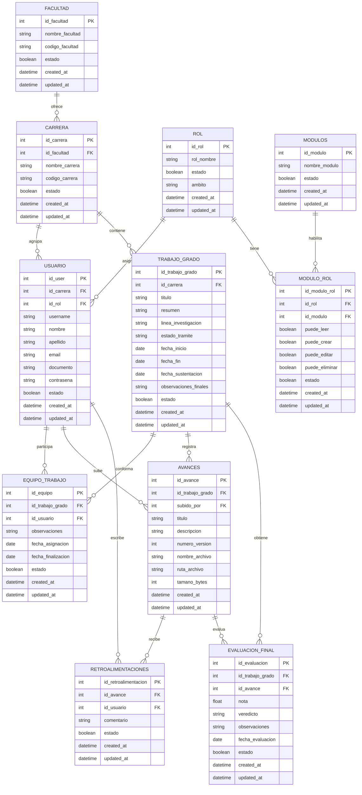

# Plataforma de seguimiento de trabajos de grado

API REST para gestionar información académica relacionada con trabajos de grado: usuarios y roles, facultades y carreras, equipos, avances, retroalimentaciones y evaluaciones.

El backend está construido con FastAPI y Python. Se conecta a PostgreSQL mediante `psycopg2` y organiza el acceso a datos en repositorios.

## Funcionalidades

- Inicio de sesión con correo y contraseña, y emisión de tokens JWT.
- Administración de usuarios, roles, facultades, carreras y módulos.
- Registro de trabajos de grado y asignación de integrantes a equipos.
- Registro de avances con metadatos de archivos, fechas, estado y dictamen.
- Registro y consulta de retroalimentaciones y evaluaciones.
- Control por rol implementado para las rutas de usuarios y para la consulta de evaluaciones del usuario autenticado.

## Tecnologías

- Python, FastAPI, Pydantic y Uvicorn.
- PostgreSQL y `psycopg2-binary`.
- JWT (`PyJWT`) y bcrypt para autenticación y contraseñas.
- `python-dotenv` para cargar la configuración local.

## Estructura

```text
.
├── app/
│   ├── api/           # Rutas HTTP
│   ├── core/          # Conexión a PostgreSQL y seguridad
│   ├── models/        # Modelos de entrada y datos
│   ├── repositories/  # Consultas y operaciones de persistencia
│   └── main.py        # Aplicación FastAPI y registro de routers
├── DB/
│   └── DB_final.pdf      # Diagrama del modelo de datos
├── requirements.txt
└── README.md
```

## Requisitos

- Python 3.10 o posterior (el código usa anotaciones de tipo `X | None`).
- Una instancia PostgreSQL accesible desde el entorno donde se ejecuta la API. La conexión está configurada con `sslmode=require`.

## Configuración y ejecución

1. Crea y activa un entorno virtual:

   ```bash
   python -m venv .venv
   ```

   En Windows PowerShell:

   ```powershell
   .\.venv\Scripts\Activate.ps1
   ```

   En macOS o Linux:

   ```bash
   source .venv/bin/activate
   ```

2. Instala las dependencias:

   ```bash
   pip install -r requirements.txt
   ```

3. Crea un archivo `.env` en la raíz del proyecto. Define las credenciales de una base PostgreSQL y una clave privada para firmar tokens:

   ```env
   DB_HOST=localhost
   DB_NAME=trabajos_grado
   DB_USER=postgres
   DB_PASSWORD=tu contraseña
   DB_PORT=5432
   SECRET_KEY=reemplaza-por-una-clave-aleatoria-larga
   FRONTEND_URL=http://localhost:5173
   ```

   `FRONTEND_URL` es opcional; si no se define, el backend usa `http://localhost:5173`. La configuración CORS también permite los orígenes `localhost:5173` y `127.0.0.1:5173`. No publiques el archivo `.env` ni compartas sus secretos.

4. Inicia la API desde la raíz del repositorio:

   ```bash
   uvicorn app.main:app --reload
   ```

La API queda disponible en `http://127.0.0.1:8000`. FastAPI genera la documentación interactiva en:

- Swagger UI: `http://127.0.0.1:8000/docs`
- ReDoc: `http://127.0.0.1:8000/redoc`

## Rutas disponibles

Las rutas con `{id_...}` reciben el identificador correspondiente. Los endpoints de listado aceptan los parámetros de consulta indicados.

| Recurso | Rutas |
| --- | --- |
| Autenticación | `POST /auth/login` |
| Usuarios | `GET /usuarios/`, `GET /usuarios/{id_user}`, `POST /usuarios/`, `PUT /usuarios/{id_user}`, `DELETE /usuarios/{id_user}` |
| Roles | `GET /rol/`, `GET /rol/{id_rol}`, `POST /rol/`, `PUT /rol/{id_rol}`, `DELETE /rol/{id_rol}` |
| Facultades | `GET /facultades/`, `GET /facultades/{id_facultad}`, `POST /facultades/`, `PUT /facultades/{id_facultad}`, `DELETE /facultades/{id_facultad}` |
| Carreras | `GET /carreras/`, `GET /carreras/{id_carrera}`, `POST /carreras/`, `PUT /carreras/{id_carrera}`, `DELETE /carreras/{id_carrera}` |
| Trabajos de grado | `GET /trabajo_grado/`, `GET /trabajo_grado/{id_trabajo_grado}`, `POST /trabajo_grado/`, `PUT /trabajo_grado/{id_trabajo_grado}`, `DELETE /trabajo_grado/{id_trabajo_grado}` |
| Equipos de trabajo | `GET /equipo-trabajo/`, `GET /equipo-trabajo/{id_equipo}`, `GET /equipo-trabajo/estudiante/{id_user}`, `GET /equipo-trabajo/docente/{id_user}`, `GET /equipo-trabajo/trabajo/{id_trabajo_grado}`, `POST /equipo-trabajo/`, `PUT /equipo-trabajo/{id_equipo}`, `DELETE /equipo-trabajo/{id_equipo}` |
| Avances | `GET /avances/` (opcional: `id_trabajo_grado`), `GET /avances/trabajo/{id_trabajo_grado}`, `GET /avances/{id_avance}`, `POST /avances/`, `PUT /avances/{id_avance}`, `DELETE /avances/{id_avance}` |
| Retroalimentaciones | `GET /retroalimentaciones/`, `GET /retroalimentaciones/{id_retroalimentacion}`, `GET /retroalimentaciones/trabajo/{id_trabajo_grado}`, `POST /retroalimentaciones/`, `PUT /retroalimentaciones/{id_retroalimentacion}`, `DELETE /retroalimentaciones/{id_retroalimentacion}` |
| Evaluaciones | `GET /evaluaciones/` (opcionales: `id_carrera`, `id_facultad`), `GET /evaluaciones/mi-trabajo`, `GET /evaluaciones/{id_evaluacion}`, `POST /evaluaciones/`, `PUT /evaluaciones/{id_evaluacion}`, `DELETE /evaluaciones/{id_evaluacion}` |
| Módulos | `GET /modulos/`, `GET /modulos/{id_modulo}`, `POST /modulos/`, `PUT /modulos/{id_modulo}`, `DELETE /modulos/{id_modulo}` |
| Módulo por rol | `GET /modulo_rol/`, `GET /modulo_rol/{id_modulo_rol}`, `POST /modulo_rol/`, `PUT /modulo_rol/{id_modulo_rol}`, `DELETE /modulo_rol/{id_modulo_rol}` |

### Autenticación y permisos

Envía `POST /auth/login` con un cuerpo JSON como:

```json
{
  "email": "usuario@ejemplo.com",
  "contrasena": "tu contraseña"
}
```

Las rutas de usuarios requieren un token Bearer. Según el rol, permiten consultar, crear, actualizar o eliminar usuarios; el identificador de rol se define en `app/core/security.py` (administrador `1`, coordinador `2`, docente `4`, estudiante `5`). `GET /evaluaciones/mi-trabajo` también requiere token y está restringida al rol estudiante. El token JWT vence después de 60 minutos. Revisa las rutas y dependencias de seguridad antes de exponer la API públicamente: no todos los routers declaran autenticación.

## Base de datos

El siguiente diagrama ER está basado en las entidades y relaciones del archivo [`DB/DB_final.pdf`](DB/DB_final.pdf):



La aplicación lee `DB_HOST`, `DB_NAME`, `DB_USER`, `DB_PASSWORD` y `DB_PORT` desde el entorno al abrir una conexión. Verifica que la base configurada tenga las tablas y columnas que esperan los repositorios de `app/repositories/` antes de iniciar operaciones.

## Autores

- Owen Sanchez
- Jenifer Camacho

Corporación Universitaria Latinoamericana (CUL).
